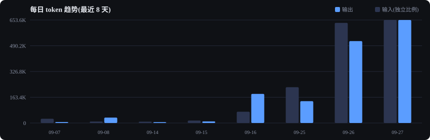
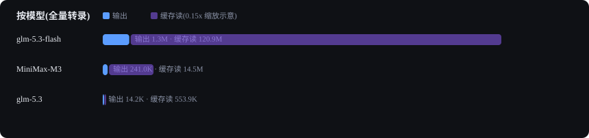
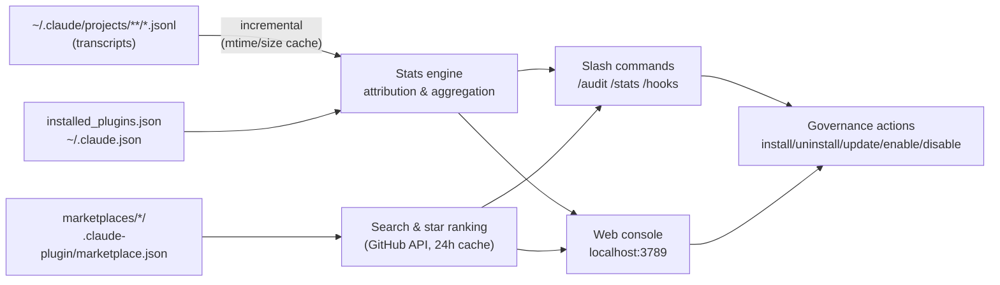

<div align="center">


# 🛎️ cc-butler

**The plugin butler for Claude Code — govern your plugins, know your tokens.**

[](LICENSE)


[](https://github.com/yzy123yzy/cc-butler/stargazers)



*Your plugins' real token bill, hook-by-hook visibility, one-click governance — all local, zero overhead.*

**English** | [简体中文](README.zh-CN.md)

</div>

---

## Why cc-butler?

Claude Code's plugin ecosystem is growing fast — memory plugins, LSPs, MCP servers, skill packs. But three questions had no good answer:

1. **"Which plugin is eating my tokens?"** — usage analyzers (like [ccusage](https://github.com/ryoppippi/ccusage)) show *your* tokens, not *per-plugin* attribution.
2. **"What is this plugin doing inside my sessions?"** — plugins can register hooks that run on **every tool call**.
3. **"Which ones should I keep?"** — no tool tells you what's actually used vs. dead weight.

**cc-butler is a plugin *governor*, not another usage dashboard** — every stat lands in an actionable suggestion: *uninstall candidate / disable candidate / keep*.

## ✨ Features

- 🛎️ **Plugin Governance** — `/audit` grades every installed plugin (🔴 uninstall / 🟡 disable / 👀 watch / 🟢 keep) with reasons and one-click actions
- 🕵️ **Hooks Security Profile** — see *when* each plugin's hooks fire and *what* they execute, with heuristic risk signals (network / file writes / sensitive env vars / obfuscation)
- 📊 **Token Analytics** — per model / day / project / **skill attribution**; interactive vs. background SDK sessions tracked separately (catches memory-plugin background burn)
- 🧩 **MCP Governance** — user & local MCP servers inventoried with usage and one-click removal
- 📦 **Full Lifecycle** — search marketplaces (293+ plugins), install / uninstall / update / enable / disable, from slash commands or the web UI
- 🌐 **Web Console** — localhost dashboard with charts and in-page action buttons (binds 127.0.0.1 only)
- 🚀 **Statusline Integration** — one line in your Claude Code status bar: today's ↑out ↓in ⟳cache
- ⚡ **Zero Overhead** — no hooks, no MCP server, nothing injected into sessions; works only when invoked
- 🔒 **Local-first** — all data from local transcripts; the only network call is read-only GitHub stars (24h cache)
- 🆓 **Zero Dependencies** — Node.js built-ins only, no npm install

## 🚀 Installation

```bash
# 1. Add the marketplace
claude plugin marketplace add yzy123yzy/cc-butler

# 2. Install
claude plugin install cc-butler@cc-butler
```

Restart your Claude Code session. Requires Node.js ≥ 18.

<details>
<summary>💡 Development mode</summary>

```bash
git clone https://github.com/yzy123yzy/cc-butler.git
cd cc-butler
claude --plugin-dir ./plugin
```
</details>

## 📖 Usage

### Slash commands

```bash
/cc-butler:stats 30              # token + usage report (--web launches the dashboard)
/cc-butler:audit                 # plugin health check → graded suggestions → one-click actions
/cc-butler:hooks claude-mem      # who fires what, when — per-plugin hook profile
/cc-butler:search memory         # search marketplaces (with GitHub stars)
/cc-butler:info claude-mem       # stars + local usage + component cost
/cc-butler:install <name>        # install (with confirmation)
/cc-butler:uninstall <name>      # uninstall (with confirmation)
/cc-butler:update all            # update everything
```

### Web console

```bash
/cc-butler:stats --web           # or: node plugin/scripts/web.js
```

Then open <http://localhost:3789> — Overview / Skills / **Plugin management** (update·disable·uninstall buttons, MCP servers) / **Market** (⭐ ranking, in-page install).

### Statusline

Add to `~/.claude/settings.json`:

```json
{
  "statusLine": {
    "type": "command",
    "command": "node \"<path-to-cc-butler>/plugin/scripts/statusline.cjs\""
  }
}
```

Output: `🛎️ 今日 ↑653.6K ↓4.0M ⟳63.0M` (↑output ↓input ⟳cache-read today)

### CLI (works outside Claude Code)

```bash
node plugin/scripts/butler.cjs stats 30 --json
node plugin/scripts/butler.cjs audit --json
node plugin/scripts/butler.cjs mcp          # MCP server inventory
node plugin/scripts/butler.cjs skills       # every installed skill
```

## 📊 Dashboard




*Charts above are generated from a real local machine via `node docs/gen-charts.cjs`.*

## 🆚 How it compares

| | **cc-butler** | [ccusage](https://github.com/ryoppippi/ccusage) | claude-monitor | claude-trace |
|---|---|---|---|---|
| Plugin governance (install/uninstall/update/enable) | ✅ | ❌ | ❌ | ❌ |
| Per-plugin / per-skill usage attribution | ✅ | ❌ | ❌ | session-level |
| MCP server governance | ✅ | ❌ | ❌ | ❌ |
| Background SDK session visibility | ✅ session counts | ❌ | ❌ | ❌ |
| Token reports | ✅ | ✅✅ | real-time | ✅ |
| USD cost estimates (Anthropic pricing) | ⛔ by design* | ✅ | ✅ | ✅ |
| Web console with in-page actions | ✅ | ❌ | ❌ | ❌ |
| Form factor | Claude Code plugin | npm CLI | npm CLI | CLI |

\* cc-butler deliberately skips USD estimates: on third-party endpoints (GLM, proxies…) Anthropic pricing is wrong, and wrong numbers are worse than no numbers. Token counts stay accurate.

## 🧠 FAQ

**Q: Can I really see how many tokens a specific plugin used?**
Three layers: ① in-session skill/MCP calls → attributable (heuristic but grounded in transcripts); ② context bloat from plugin injections → use `claude plugin details <name>` for the official estimate; ③ plugin background processes → separate transcripts, session counts always visible (token counts depend on your endpoint returning usage).

**Q: Will it slow down my sessions?**
No. cc-butler registers no hooks and no MCP server — it costs zero tokens until you invoke it. That's a deliberate design contrast with memory plugins that fire on every tool call.

**Q: Is my data sent anywhere?**
No. Everything is computed locally from `~/.claude/`. The single network call is GitHub's public API for star counts, cached 24h.

**Q: How accurate are the numbers?**
Totals are verified bit-for-bit against independent recomputation from raw transcripts. Skill token attribution is heuristic (from a Skill call to its tool_result) and labeled as such.

## ⚙️ How it works



## 🗺️ Roadmap

- [ ] Per-project plugin scoping (`butler scope <project> <plugin> on/off`)
- [ ] Redundant-plugin detection (two memory plugins? converge.)
- [ ] Budget alerts (background session thresholds)
- [ ] Cost estimation for configurable price tables (opt-in, for standard Anthropic billing)

## ⭐ Star History

[](https://star-history.com/#yzy123yzy/cc-butler&Date)

## License

[MIT](LICENSE)
