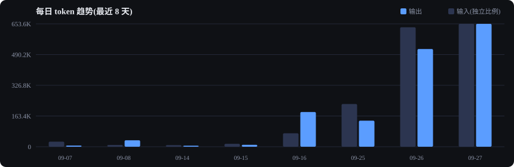
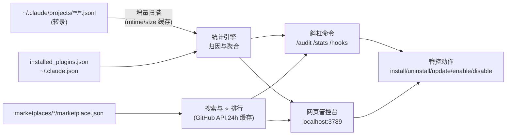

<div align="center">


# 🛎️ cc-butler

**Claude Code 插件管家 —— 管控你的插件,看清你的 token。**

[](LICENSE)


[](https://github.com/yzy123yzy/cc-butler/stargazers)



*插件的 token 账单、逐条 hooks 可见性、一键管控 —— 全本地,零开销。*

[English](README.md) | **简体中文**

</div>

---

## 为什么做 cc-butler?

Claude Code 插件生态正在爆发:memory 插件、LSP、MCP 服务器、技能包……但三个问题一直没人答好:

1. **"哪个插件在烧我的 token?"** —— 用量分析工具(如 [ccusage](https://github.com/ryoppippi/ccusage))统计的是*你*的 token,不是*按插件*归因。
2. **"这个插件在我的会话里干了什么?"** —— 插件可以注册 hooks,**每次工具调用**都会执行。
3. **"哪些该留、哪些该卸?"** —— 没有工具告诉你什么在用、什么是死重。

**cc-butler 定位是插件「管控」,不是又一个用量仪表盘** —— 每一项统计都落到建议动作:*卸载候选 / 禁用观察 / 保留*。

## ✨ 特性

- 🛎️ **插件体检** `/audit`:已装插件逐个分级(🔴卸载候选 / 🟡禁用观察 / 👀关注 / 🟢保留),带理由与一键执行
- 🕵️ **hooks 安全画像**:每个插件的 hooks 在什么时机、以什么命令触碰会话,启发式风险信号(网络访问 / 写文件 / 敏感环境变量 / 混淆执行)
- 📊 **token 分析**:按模型 / 日期 / 项目 / **技能归因**;交互与后台 SDK 会话分列(让 memory 类插件的后台消耗现形)
- 🧩 **MCP 管控**:user / local 级 MCP 服务器进清单,带使用统计与一键移除
- 📦 **全生命周期**:搜索市场(293+ 插件)、安装 / 卸载 / 更新 / 启停,斜杠命令与网页皆可
- 🌐 **网页管控台**:localhost 仪表盘,图表 + 页内操作按钮(仅绑 127.0.0.1)
- 🚀 **状态栏集成**:Claude Code 状态栏一行显示今日 ↑输出 ↓输入 ⟳缓存读
- ⚡ **零常驻开销**:无 hooks、无 MCP server,不往会话注入任何内容,调用时才工作
- 🔒 **本地优先**:统计全部来自本地转录;唯一网络调用是只读的 GitHub stars(24h 缓存)
- 🆓 **零依赖**:只用 Node.js 内置模块,无需 npm install

## 🚀 安装

```bash
# 1. 添加市场
claude plugin marketplace add yzy123yzy/cc-butler

# 2. 安装
claude plugin install cc-butler@cc-butler
```

重启 Claude Code 会话生效。要求 Node.js ≥ 18。

<details>
<summary>💡 开发模式</summary>

```bash
git clone https://github.com/yzy123yzy/cc-butler.git
cd cc-butler
claude --plugin-dir ./plugin
```
</details>

## 📖 使用

### 斜杠命令

```bash
/cc-butler:stats 30              # token + 使用频率报表(--web 顺带启动网页)
/cc-butler:audit                 # 插件体检 → 分级建议 → 一键执行
/cc-butler:hooks claude-mem      # 谁、在什么时机、执行什么命令
/cc-butler:search memory         # 搜索市场插件(含 GitHub stars)
/cc-butler:info claude-mem       # stars + 本机使用 + 组件开销
/cc-butler:install <名称>        # 安装(先确认)
/cc-butler:uninstall <名称>      # 卸载(先确认)
/cc-butler:update all            # 全部更新
```

### 网页管控台

```bash
/cc-butler:stats --web           # 或:node plugin/scripts/web.js
```

打开 <http://localhost:3789> —— 总览 / 技能 / **插件管理**(更新·禁用·卸载按钮、MCP 清单)/ **市场**(⭐ 排行、页内安装)。

### 状态栏

`~/.claude/settings.json` 添加:

```json
{
  "statusLine": {
    "type": "command",
    "command": "node \"<cc-butler 路径>/plugin/scripts/statusline.cjs\""
  }
}
```

输出:`🛎️ 今日 ↑653.6K ↓4.0M ⟳63.0M`(↑输出 ↓输入 ⟳缓存读)

### 命令行(不进会话也能用)

```bash
node plugin/scripts/butler.cjs stats 30 --json
node plugin/scripts/butler.cjs audit --json
node plugin/scripts/butler.cjs mcp          # MCP 服务器清单
node plugin/scripts/butler.cjs skills       # 已安装技能全清单
```

## 📊 仪表盘一览


*以上图表由真实本机数据生成,可用 `node docs/gen-charts.cjs` 重新生成你自己的。*

## 🆚 与同类工具对比

| | **cc-butler** | [ccusage](https://github.com/ryoppippi/ccusage) | claude-monitor | claude-trace |
|---|---|---|---|---|
| 插件管控(装/卸/更新/启停) | ✅ | ❌ | ❌ | ❌ |
| 按插件 / 技能使用归因 | ✅ | ❌ | ❌ | 会话级 |
| MCP 服务器管控 | ✅ | ❌ | ❌ | ❌ |
| 后台 SDK 会话可见性 | ✅ 会话数 | ❌ | ❌ | ❌ |
| token 报表 | ✅ | ✅✅ | 实时 | ✅ |
| 美元费用估算(Anthropic 价目) | ⛔ 刻意不做* | ✅ | ✅ | ✅ |
| 网页管控台(页内操作) | ✅ | ❌ | ❌ | ❌ |
| 形态 | Claude Code 插件 | npm CLI | npm CLI | CLI |

\* 第三方端点(GLM、代理等)下 Anthropic 价目是错的——错误的数字比没有数字更糟,所以只报 token,token 永远准确。

## 🧠 FAQ

**Q: 真能知道某个插件用了多少 token 吗?**
分三层:① 会话内的 skill/MCP 调用 → 可归因(启发式,但以转录为据);② 插件注入对上下文的膨胀 → 用官方 `claude plugin details <名称>` 看预估;③ 插件后台进程 → 独立转录,会话数始终可见(token 数取决于端点是否回传 usage)。

**Q: 会拖慢我的会话吗?**
不会。cc-butler 不注册任何 hooks 和 MCP server——调用之前零 token 消耗。这正是它与"每次工具调用都触发"的 memory 类插件的刻意对比。

**Q: 数据会上传吗?**
不会。一切本地计算;唯一网络调用是 GitHub 公开 API 查 stars,24h 缓存。

**Q: 数字准吗?**
总量已与独立逐行重算**逐位一致**验证;技能 token 归因为启发式(从 Skill 调用到对应 tool_result),界面中明确标注。

## ⚙️ 工作原理



## 🗺️ 路线图

- [ ] 按项目作用域管控(`butler scope <项目> <插件> on/off`)
- [ ] 冗余插件检测(装了两个 memory 插件?该收敛了)
- [ ] 预算告警(后台会话阈值提醒)
- [ ] 可配置价目的费用估算(可选,标准 Anthropic 计费用户)

## ⭐ Star History

[](https://star-history.com/#yzy123yzy/cc-butler&Date)

## License

[MIT](LICENSE)
